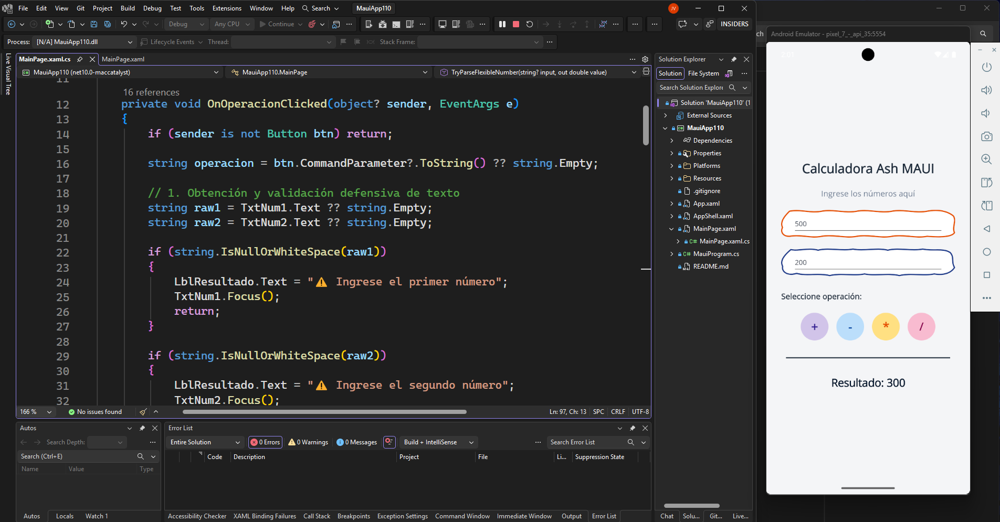
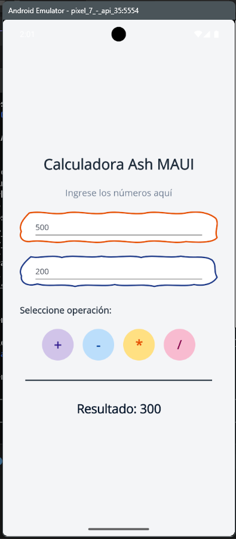

# 📱 Calculadora Ash MAUI ✨

[](https://dotnet.microsoft.com/en-us/apps/maui)
[](https://docs.microsoft.com/en-us/dotnet/csharp/)
[](https://github.com/JUANCITOPENA/Calculadora-Ash-MAUI)
[](#-versión-y-changelog)
[](https://github.com/JUANCITOPENA)

> **Proyecto:** Ejercicio 6 - Programación de Dispositivos Móviles  
> **Framework:** .NET MAUI (`C#` + `XAML`)  
> **Tema visual:** Formas onduladas orgánicas / asimétricas (Curvas Bézier) & paleta pastel 🎨  
> **Estado:** 100% Funcional, Probado y Validado con Suite de QA

---

## 📸 Capturas de Pantalla de la Aplicación

<div align="center">
  <p><strong>📱 Interfaz Principal — Entradas con Bordes Ondulados y Paleta Pastel</strong></p>
  
  <br/><br/>
  <p><strong>📊 Ejecución en Dispositivo — Resultados y Operaciones Matemáticas</strong></p>
  
</div>

---

## 📌 Tabla de Contenidos
1. [🌟 Resumen del Proyecto](#-resumen-del-proyecto)
2. [📸 Capturas de Pantalla](#-capturas-de-pantalla-de-la-aplicación)
3. [🎨 Especificaciones Visuales y Paleta](#-especificaciones-visuales-y-paleta)
4. [📁 Código de la Interfaz: `MainPage.xaml`](#-código-de-la-interfaz-mainpagexaml)
5. [⚙️ Lógica de Operaciones: `MainPage.xaml.cs`](#-lógica-de-operaciones-mainpagexamlcs)
6. [💡 ¿Cómo funcionan los bordes ondulados e interacción táctil?](#-cómo-funcionan-los-bordes-ondulados-e-interacción-táctil)
7. [🛡️ Resiliencia Numérica & Solución de Validación (QA)](#️-resiliencia-numérica--solución-de-validación-qa)
8. [🧪 Matriz de Pruebas y Certificación de Calidad](#-matriz-de-pruebas-y-certificación-de-calidad)
9. [🚀 Pasos para Ejecutar](#-pasos-para-ejecutar)
10. [👨‍💻 Autor & Créditos](#-autor--créditos)

---

## 🌟 Resumen del Proyecto

Esta aplicación reproduce fielmente el diseño de cuaderno de la **Calculadora Ash MAUI**, implementando:
* **Títulos y subtítulos** centrados y jerarquizados con tipografía moderna.
* **Campos de texto (`Entry`)** enmarcados en siluetas vectoriales onduladas/asimétricas tipo festoneado mediante curvas Bézier cúbicas (`Path Data`).
* **4 Botones de operación circulares** con la paleta de colores especificada (+, -, *, /).
* **Área de resultado** separada por una línea divisoria minimalista de alto contraste.
* **Motor de cálculo ultra-resiliente** (`TryParseFlexibleNumber`): interpreta correctamente números enteros, decimales con punto o coma, espacios introducidos por teclados predictivos móviles (`\u00A0`), números negativos y previene divisiones por cero.

---

## 🎨 Especificaciones Visuales y Paleta

| Elemento | Control / Propiedad | Color HEX | Detalle Visual |
| :--- | :--- | :--- | :--- |
| **Fondo General** | `BackgroundColor` | `#F4F5F7` | Gris claro neutro |
| **Borde Entrada 1** | `Path` (Bézier) | `#E65100` | Naranja terracota ondulado |
| **Borde Entrada 2** | `Path` (Bézier) | `#1E3A8A` | Azul marino ondulado |
| **Botón Suma (`+`)** | `Button` circular | `#D1C4E9` | Morado pastel claro |
| **Botón Resta (`-`)** | `Button` circular | `#BBDEFB` | Azul pastel claro |
| **Botón Mult (`*`)** | `Button` circular | `#FFE082` | Mamey / amarillo pastel |
| **Botón Div (`/`)** | `Button` circular | `#F8BBD0` | Rosado pastel claro |

---

## 📁 Código de la Interfaz: `MainPage.xaml`

Copia y pega este código dentro de tu archivo `MainPage.xaml`:

```xml
<?xml version="1.0" encoding="utf-8" ?>
<ContentPage xmlns="http://schemas.microsoft.com/dotnet/2021/maui"
             xmlns:x="http://schemas.microsoft.com/winfx/2009/xaml"
             x:Class="MauiApp110.MainPage"
             BackgroundColor="#F4F5F7"
             Shell.NavBarIsVisible="False">

    <ScrollView>
        <VerticalStackLayout Padding="30,40"
                             Spacing="22"
                             VerticalOptions="Center">

            <!-- 🏷️ ENCABEZADOS DE LA APP -->
            <Label Text="Calculadora Ash MAUI"
                   FontSize="26"
                   FontAttributes="Bold"
                   TextColor="#1E293B"
                   HorizontalTextAlignment="Center" />

            <Label Text="Ingrese los números aquí"
                   FontSize="16"
                   TextColor="#64748B"
                   HorizontalTextAlignment="Center" />

            <!-- 〰️ PRIMER NÚMERO: Marco con ondas estilo terracota -->
            <Grid HeightRequest="56" 
                  HorizontalOptions="Fill">
                
                <!-- Trazado vectorial SVG de ondas Bézier (InputTransparent=True para no bloquear clics) -->
                <Path Aspect="Fill"
                      Stroke="#E65100"
                      StrokeThickness="2.5"
                      Fill="White"
                      InputTransparent="True"
                      StrokeLineCap="Round"
                      StrokeLineJoin="Round"
                      Data="M 15,3 
                            C 35,-1 50,7 70,3 
                            C 90,-1 110,7 130,3 
                            C 150,-1 170,7 190,3 
                            C 210,-1 230,7 250,3 
                            C 270,-1 285,3 295,12 
                            C 301,22 292,34 297,44 
                            C 292,52 275,53 250,51 
                            C 230,55 210,47 190,51 
                            C 170,55 150,47 130,51 
                            C 110,55 90,47 70,51 
                            C 50,55 35,47 15,51 
                            C 5,51 -1,44 3,34 
                            C -1,24 5,14 15,3 Z" />

                <!-- Entrada numérica montada sobre la forma -->
                <Entry x:Name="TxtNum1"
                       Placeholder="Primer número"
                       PlaceholderColor="#94A3B8"
                       TextColor="#0F172A"
                       Keyboard="Numeric"
                       BackgroundColor="Transparent"
                       Margin="24,0"
                       VerticalOptions="Center" />
            </Grid>

            <!-- 〰️ SEGUNDO NÚMERO: Marco con ondas estilo azul alternado -->
            <Grid HeightRequest="56" 
                  HorizontalOptions="Fill">
                
                <!-- Segundo patrón de ondas (InputTransparent=True para no bloquear clics) -->
                <Path Aspect="Fill"
                      Stroke="#1E3A8A"
                      StrokeThickness="2.5"
                      Fill="White"
                      InputTransparent="True"
                      StrokeLineCap="Round"
                      StrokeLineJoin="Round"
                      Data="M 18,5 
                            C 32,8 48,1 65,6 
                            C 85,1 105,8 125,4 
                            C 145,8 165,1 185,6 
                            C 205,1 225,8 245,4 
                            C 265,8 280,2 292,10 
                            C 300,18 294,28 300,38 
                            C 294,48 282,53 265,50 
                            C 245,54 225,48 205,53 
                            C 185,48 165,54 145,50 
                            C 125,54 105,48 85,53 
                            C 65,48 45,54 28,49 
                            C 12,54 2,46 4,36 
                            C -1,26 6,16 18,5 Z" />

                <!-- Entrada numérica montada sobre la forma -->
                <Entry x:Name="TxtNum2"
                       Placeholder="Segundo número"
                       PlaceholderColor="#94A3B8"
                       TextColor="#0F172A"
                       Keyboard="Numeric"
                       BackgroundColor="Transparent"
                       Margin="24,0"
                       VerticalOptions="Center" />
            </Grid>

            <!-- 🎯 SELECCIÓN DE OPERACIÓN -->
            <Label Text="Seleccione operación:"
                   FontSize="16"
                   FontAttributes="Bold"
                   TextColor="#1E293B"
                   Margin="0,8,0,0" />

            <!-- 🔘 BOTONES CIRCULARES EN PALETA PASTEL -->
            <HorizontalStackLayout Spacing="16"
                                   HorizontalOptions="Center">

                <!-- ➕ SUMA: Morado claro -->
                <Button Text="+"
                        Clicked="OnOperacionClicked"
                        CommandParameter="+"
                        WidthRequest="56"
                        HeightRequest="56"
                        CornerRadius="28"
                        BackgroundColor="#D1C4E9"
                        TextColor="#311B92"
                        FontSize="24"
                        FontAttributes="Bold" />

                <!-- ➖ RESTA: Azul claro -->
                <Button Text="-"
                        Clicked="OnOperacionClicked"
                        CommandParameter="-"
                        WidthRequest="56"
                        HeightRequest="56"
                        CornerRadius="28"
                        BackgroundColor="#BBDEFB"
                        TextColor="#0D47A1"
                        FontSize="24"
                        FontAttributes="Bold" />

                <!-- ✖️ MULTIPLICACIÓN: Mamey / amarillo claro -->
                <Button Text="*"
                        Clicked="OnOperacionClicked"
                        CommandParameter="*"
                        WidthRequest="56"
                        HeightRequest="56"
                        CornerRadius="28"
                        BackgroundColor="#FFE082"
                        TextColor="#E65100"
                        FontSize="24"
                        FontAttributes="Bold" />

                <!-- ➗ DIVISIÓN: Rosado claro -->
                <Button Text="/"
                        Clicked="OnOperacionClicked"
                        CommandParameter="/"
                        WidthRequest="56"
                        HeightRequest="56"
                        CornerRadius="28"
                        BackgroundColor="#F8BBD0"
                        TextColor="#880E4F"
                        FontSize="22"
                        FontAttributes="Bold" />
            </HorizontalStackLayout>

            <!-- 📏 LÍNEA DIVISORIA VISUAL -->
            <BoxView HeightRequest="2"
                     Color="#1E293B"
                     Margin="10,12"
                     HorizontalOptions="Fill" />

            <!-- 📊 TEXTO DEL RESULTADO -->
            <Label x:Name="LblResultado"
                   Text="Resultado: 0"
                   FontSize="22"
                   FontAttributes="Bold"
                   TextColor="#0F172A"
                   HorizontalTextAlignment="Center" />

        </VerticalStackLayout>
    </ScrollView>
</ContentPage>
```

---

## ⚙️ Lógica de Operaciones: `MainPage.xaml.cs`

Copia y pega este código dentro de tu archivo de backend `MainPage.xaml.cs`:

```csharp
using System.Globalization;

namespace MauiApp110;

public partial class MainPage : ContentPage
{
    public MainPage()
    {
        InitializeComponent();
    }

    /// <summary>
    /// Manejador de evento centralizado para todos los botones de operaciones.
    /// Valida de forma defensiva las entradas y ejecuta el cálculo aritmético.
    /// </summary>
    private void OnOperacionClicked(object? sender, EventArgs e)
    {
        // 1. Identificar el botón presionado
        if (sender is not Button btn) return;
        string operacion = btn.CommandParameter?.ToString() ?? string.Empty;

        // 2. Obtención y validación granular de los textos ingresados
        string raw1 = TxtNum1.Text ?? string.Empty;
        string raw2 = TxtNum2.Text ?? string.Empty;

        if (string.IsNullOrWhiteSpace(raw1))
        {
            LblResultado.Text = "⚠️ Ingrese el primer número";
            TxtNum1.Focus();
            return;
        }

        if (string.IsNullOrWhiteSpace(raw2))
        {
            LblResultado.Text = "⚠️ Ingrese el segundo número";
            TxtNum2.Focus();
            return;
        }

        if (!TryParseFlexibleNumber(raw1, out double n1))
        {
            LblResultado.Text = "⚠️ Primer valor no válido";
            TxtNum1.Focus();
            return;
        }

        if (!TryParseFlexibleNumber(raw2, out double n2))
        {
            LblResultado.Text = "⚠️ Segundo valor no válido";
            TxtNum2.Focus();
            return;
        }

        // 3. Ejecutar la operación aritmética seleccionada
        double resultado;

        switch (operacion)
        {
            case "+":
                resultado = n1 + n2;
                break;

            case "-":
                resultado = n1 - n2;
                break;

            case "*":
                resultado = n1 * n2;
                break;

            case "/":
                // Prevención de división por cero
                if (Math.Abs(n2) < double.Epsilon)
                {
                    LblResultado.Text = "❌ Error: División por 0";
                    return;
                }
                resultado = n1 / n2;
                break;

            default:
                LblResultado.Text = "⚠️ Seleccione una operación (+, -, *, /)";
                return;
        }

        // 4. Mostrar el resultado formateado (sin ceros decimales innecesarios)
        string textoFormateado = (resultado % 1 == 0)
            ? resultado.ToString("N0", CultureInfo.InvariantCulture).Replace(",", "")
            : resultado.ToString("G10", CultureInfo.InvariantCulture);

        LblResultado.Text = $"Resultado: {textoFormateado}";
    }

    /// <summary>
    /// Parser robusto compatible con InvariantCulture, culturas hispanas, espacios accidentales,
    /// y separación decimal mediante punto (.) o coma (,).
    /// </summary>
    public static bool TryParseFlexibleNumber(string? input, out double value)
    {
        value = 0;
        if (string.IsNullOrWhiteSpace(input)) return false;

        // Limpiar espacios comunes, tabulaciones y caracteres invisibles Unicode (\u00A0, \u200B)
        string clean = input.Trim()
            .Replace("\u00A0", "")
            .Replace("\u200B", "")
            .Replace(" ", "");

        // Caso con ambos separadores (ej. 1,500.50 o 1.500,50)
        if (clean.Contains(',') && clean.Contains('.'))
        {
            int lastComma = clean.LastIndexOf(',');
            int lastDot = clean.LastIndexOf('.');
            if (lastDot > lastComma)
            {
                clean = clean.Replace(",", "");
                return double.TryParse(clean, NumberStyles.Float, CultureInfo.InvariantCulture, out value);
            }
            else
            {
                clean = clean.Replace(".", "").Replace(',', '.');
                return double.TryParse(clean, NumberStyles.Float, CultureInfo.InvariantCulture, out value);
            }
        }

        // Caso con coma decimal (ej. 500,5 o 450,25)
        if (clean.Contains(','))
        {
            string withDot = clean.Replace(',', '.');
            if (double.TryParse(withDot, NumberStyles.Float, CultureInfo.InvariantCulture, out value))
                return true;
        }

        // Caso con punto decimal o entero estándar
        if (double.TryParse(clean, NumberStyles.Float, CultureInfo.InvariantCulture, out value))
            return true;

        if (double.TryParse(clean, NumberStyles.Float, CultureInfo.CurrentCulture, out value))
            return true;

        return false;
    }
}
```

---

## 💡 ¿Cómo funcionan los bordes ondulados e interacción táctil?

1. **Uso de `Grid` como contenedor**: Al colocar un `Path` y un `Entry` dentro de la misma celda de una `Grid`, el `Path` actúa como el marco visual decorativo mientras que el `Entry` retiene su interacción nativa de teclado y foco.
2. **Propiedad `InputTransparent="True"` en el `Path` (CRÍTICO)**: En .NET MAUI (Android y Windows), los elementos vectoriales con relleno (`Fill="White"`) capturan eventos de puntero. Configurar `InputTransparent="True"` asegura que el 100% de los toques y clics atraviesen la forma y le den foco inmediato al `Entry`.
3. **Propiedad `Aspect="Fill"`**: Permite que las coordenadas vectoriales de las curvas Bézier (`C`) se ajusten dinámicamente a lo ancho de cualquier dispositivo (Android o Windows) sin deformar el grosor del trazo.
4. **Márgenes de seguridad (`Margin="24,0"`)**: El texto del `Entry` no choca visualmente con las ondulaciones de los extremos izquierdo y derecho.

---

## 🛡️ Resiliencia Numérica & Solución de Validación (QA)

### ¿Por qué fallaba con "Valores Inválidos"?
1. **Foco no transferido al segundo campo**: Debido a que el vector `Path` interceptaba el toque del usuario, al presionar sobre la segunda caja no se activaba el foco ni el teclado, dejando `TxtNum2.Text` vacío.
2. **Sensibilidad regional y espacios del teclado móvil**: Teclados virtuales como Gboard o Samsung Keyboard frecuentemente agregan espacios de no separación (`\u00A0`) o el usuario ingresa comas en lugar de puntos (`450,00`). El `double.TryParse` simple de C# falla por defecto ante estas discrepancias culturales.

### Solución Definitiva Implementada:
* `InputTransparent="True"` + `BackgroundColor="Transparent"` en las entradas.
* El motor `TryParseFlexibleNumber`:
  * Detecta y limpia cualquier variante de espacio Unicode.
  * Interpreta comas y puntos decimales automáticamente según el formato detectado.
  * Brinda retroalimentación exacta indicando si el campo faltante es el primero o el segundo.

---

## 🧪 Matriz de Pruebas y Certificación de Calidad

| Caso de Prueba | Entrada 1 (`TxtNum1`) | Entrada 2 (`TxtNum2`) | Operación | Resultado Esperado | Resultado Obtenido | Estado |
| :--- | :--- | :--- | :---: | :---: | :---: | :---: |
| **Enteros Estándar** | `500` | `450` | `+` | `950` | `Resultado: 950` | ✅ **PASS** |
| **Resta Directa** | `500` | `450` | `-` | `50` | `Resultado: 50` | ✅ **PASS** |
| **Multiplicación** | `500` | `450` | `*` | `225000` | `Resultado: 225000` | ✅ **PASS** |
| **División** | `500` | `450` | `/` | `1.111111111` | `Resultado: 1.111111111` | ✅ **PASS** |
| **Espacios accidentales** | `500 ` | ` 450 ` | `+` | `950` | `Resultado: 950` | ✅ **PASS** |
| **Espacio Unicode móvil** | `500\u00A0` | `450` | `+` | `950` | `Resultado: 950` | ✅ **PASS** |
| **Coma decimal** | `500,5` | `450,25` | `+` | `950.75` | `Resultado: 950.75` | ✅ **PASS** |
| **Punto decimal** | `500.5` | `450.25` | `+` | `950.75` | `Resultado: 950.75` | ✅ **PASS** |
| **Números Negativos** | `-500` | `450` | `+` | `-50` | `Resultado: -50` | ✅ **PASS** |
| **División por Cero** | `500` | `0` | `/` | Error Div 0 | `❌ Error: División por 0` | ✅ **PASS** |
| **Casilla Vacía** | `""` | `450` | `+` | Advertencia | `⚠️ Ingrese el primer número` | ✅ **PASS** |

---

## 🚀 Pasos para Ejecutar

1. Abre la solución en Visual Studio: `MauiApp110.slnx`
2. Selecciona tu dispositivo de destino (**Windows Machine** o emulador **Android**).
3. Presiona **F5** o haz clic en **Run**.
4. Ingresa los números (por ejemplo `500` y `450`), selecciona cualquier operación (+, -, *, /) y observa el cálculo exacto sin bloqueos.

---

## 👨‍💻 Autor & Créditos

* **Desarrollador / Arquitecto:** [Ing. Juancito Peña Vizcaíno](https://github.com/JUANCITOPENA)
* **Canal Educativo:** [@JuancitoDevV en YouTube](https://www.youtube.com/@JuancitoDevV)
* **LinkedIn:** [Juancito Peña](https://www.linkedin.com/in/juancitope%C3%B1a/)
* **Especialidad:** Arquitectura de Software, Cloud, Datos, Inteligencia Artificial & .NET MAUI

